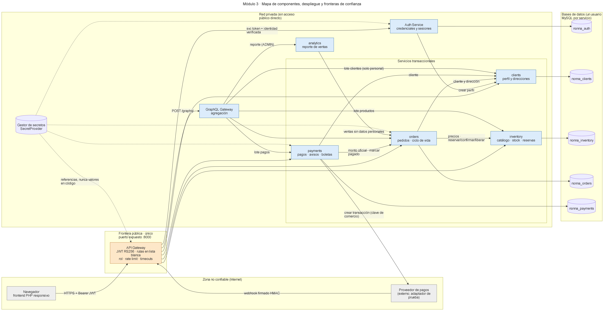
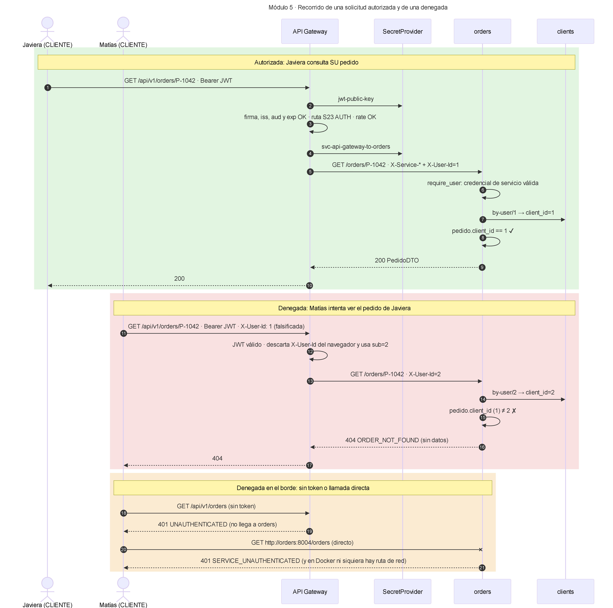

# 🍝 La Nonna — Backend seguro

**Evaluación de la Unidad 2 · Diseño e implementación de un backend seguro completo**

| | |
|---|---|
| Caso | N° **__** — Restaurante "La Nonna" (pastas frescas, Maipú) *(completar el número)* |
| Integrantes | *(completar)* |
| Versión del frontend | *(completar: commit o tag del frontend PHP)* — pantallas: `index.php`, `carta.php`, `carrito.php`, `historial.php`, `quienes_somos.php` |
| Versión del backend | este repositorio (Python 3.12+, FastAPI, MySQL 8) |
| Fecha | 09-11-2026 |

> Por indicación del profesor, la integración con el frontend no forma parte de esta entrega. Las pantallas se usan
> como fuente de requisitos y todos los servicios se prueban a través del API Gateway, igual que lo haría el navegador.

---

<a name="indice"></a>
## Índice

- [Vista general de la arquitectura](#vista-general)
- [0. Requisitos y brechas](#m0)
- [1. Módulo 1 — Servicios derivados del frontend](#m1)
- [2. Módulo 2 — Clases y cardinalidades del dominio](#m2)
- [3. Módulo 3 — Sistemas e integraciones](#m3)
- [4. Módulo 4 — Stakeholders y permisos HTTP](#m4)
- [5. Módulo 5 — API Gateway y fronteras de confianza](#m5)
- [6. Módulo 6 — Rutas y secretos de integración](#m6)
- [7. Módulo 7 — Datos sensibles y secretos del cliente](#m7)
- [8. Módulo 8 — Separación privada y agregaciones GraphQL](#m8)
- [9. Módulo 9 — Analítica y gRPC (ADR)](#m9)
- [10. Módulo 10 — Backend completo, pruebas y evidencias](#m10)
- [11. Ejecución: instalar, iniciar y probar](#ejecucion)
- [12. Estructura del repositorio y limitaciones](#estructura)

---

<a name="vista-general"></a>
## Vista general de la arquitectura

Un único **API Gateway** es público. Detrás, en una red privada, están el **Auth Service**, los microservicios **inventory, orders, clients y payments** (cada uno con su propia base MySQL y un usuario con permisos mínimos), el **GraphQL Gateway** de agregación y el servicio de **analítica**.



<sub>Figura 1 · Mapa de componentes, despliegue y fronteras de confianza · [ver en alta resolución (SVG)](nonna-backend/imagenes/03-mapa-componentes.svg) · [fuente editable](nonna-backend/docs/diagramas/03-mapa-componentes.mmd)</sub>


---

<a name="m0"></a>
## 0. Requisitos del caso y brechas declaradas

| ID | Requisito | Pantalla | Estado |
|---|---|---|---|
| R01 | Ver la carta con precios y disponibilidad | P02 `carta.php` | Implementado |
| R02 | Crear cuenta de cliente | P01 `index.php` → modal *Crear cuenta* | Implementado |
| R03 | Iniciar y cerrar sesión (cliente y trabajador) | P01 → modales *Iniciar sesión* y *Trabajadores* | Implementado |
| R04 | Armar el carrito y confirmar el pedido (despacho o retiro) | P03 `carrito.php` | Implementado (el carrito vive en el navegador; el pedido se crea al confirmar) |
| R05 | Pagar con tarjeta, transferencia o efectivo | P03 → *Tarjeta / Transferencia / Efectivo* → *Pagar* | Implementado (tarjeta con un adaptador de prueba del proveedor) |
| R06 | Ver el historial de compras con estado (Entregado / Cancelado) | P04 `historial.php` | Implementado (GraphQL `misPedidos`) |
| R07 | Seguir el estado del pedido ("Pedido en preparación") | P03 / P04 | Implementado (estados del pedido) |
| R08 | Gestión de pedidos por la cocina | **Brecha:** no hay pantalla de trabajador | Backend listo (S24, S29, `pedidosActivos`). Se incorporará como una vista *Panel cocina* después del login de trabajador |
| R09 | Administración de la carta, el stock y el personal | **Brecha:** no hay pantalla de admin | Backend listo (S06, S10–S14, S20). Vista *Administración* propuesta |
| R10 | Reporte de ventas | **Brecha:** no hay pantalla | Backend listo (`reporteVentas`, solo ADMIN) |
| R11 | Perfil y direcciones del cliente | **Brecha:** el carrito no pide la dirección | Backend listo (S15–S19). El carrito deberá agregar un selector de dirección para despacho |
| — | Información institucional | P05 `quienes_somos.php` | Contenido estático: no requiere servicio |

**Requisitos y decisiones de arquitectura.** Los requisitos R01–R11 vienen del caso y de las pantallas. Las decisiones
de arquitectura del equipo son, entre otras: separar en microservicios, usar JWT RS256, tener un solo gateway, reservar
stock y no implementar gRPC. Esas decisiones se justifican en las secciones 3, 5 y en el ADR.

---

---

<a name="m1"></a>
## 1. Módulo 1 — Servicios derivados del frontend

Escritorio y móvil comparten las mismas operaciones: la versión móvil solo cambia la disposición, así que no agrega servicios.
Las variaciones que solo cambian la presentación no generan servicios nuevos.
Los ejemplos JSON de **cada** contrato, obtenidos por ejecución, están en [contratos-ejemplos.md](nonna-backend/docs/contratos-ejemplos.md).

Clasificación de datos: **P** = público · **R** = restringido (dato personal) · **C** = credencial.

| ID | Req. | Pantalla y acción | Propósito | Verbo y ruta | Entrada | Salida | Reglas y errores | Datos | Acceso |
|---|---|---|---|---|---|---|---|---|---|
| S01 | R02 | P01 · Crear cuenta | Registrar cliente | `POST /api/v1/auth/register` | email*, password* (8–72, letras y números), first_name*, last_name*, phone (+569…), run (con DV) | 201 {id, email, role} | 409 correo repetido · 422 validación · 503 si clients falla (se compensa) | C, R | Anónimo |
| S02 | R03 | P01 · Iniciar sesión / Trabajadores | Autenticar | `POST /api/v1/auth/login` | email*, password* | 200 {access_token, expires_in, refresh_token, user} | 401 genérico · 423 bloqueo tras 5 intentos · 429 rate | C | Anónimo |
| S03 | R03 | (automático) | Renovar sesión | `POST /api/v1/auth/refresh` | refresh_token* | 200 tokens nuevos | 401 si está revocado o vencido; rota el token | C | Anónimo (con token) |
| S04 | R03 | Menú · Cerrar sesión | Revocar sesión | `POST /api/v1/auth/logout` | refresh_token* | 204 | idempotente | C | Anónimo (con token) |
| S05 | R03 | Navbar (nombre o rol) | Usuario actual | `GET /api/v1/auth/me` | — | 200 {id, email, role} | 401 | R | Autenticado |
| S06 | R09 | Brecha · Admin | Crear trabajador | `POST /api/v1/admin/staff` | email*, password*, first_name*, last_name*, position*, role* (TRABAJADOR o ADMIN) | 201 {id, email, role} | 403 si no es ADMIN · 409 | C, R | ADMIN |
| S07 | R01 | P02 · Cargar carta | Consultar catálogo | `GET /api/v1/products` | query: category, available (bool), q (2–60), page, page_size ≤100 | 200 [{id, name, description, category, price_clp, available}] · [] si no hay | 422 filtros inválidos · sin stock exacto ni SKU | P | Anónimo |
| S08 | R01 | P02 · Detalle | Consultar producto | `GET /api/v1/products/{id}` | id | 200 producto | 404 si no existe o está inactivo | P | Anónimo |
| S09 | R01 | P02 · Secciones | Listar categorías | `GET /api/v1/categories` | — | 200 [{id, name}] | — | P | Anónimo |
| S10 | R09 | Brecha · Admin | Crear producto | `POST /api/v1/products` | category_id*, sku* (A-Z0-9-), name*, description*, price_clp* (>0), initial_stock | 201 producto | 409 SKU repetido · 422 categoría | P | ADMIN |
| S11 | R09 | Brecha · Admin | Reemplazar producto | `PUT /api/v1/products/{id}` | representación completa + active | 200 producto | 404 · 409 | P | ADMIN |
| S12 | R09 | Brecha · Admin | Retirar de la carta | `DELETE /api/v1/products/{id}` | id | 204 | desactivación lógica (el historial lo referencia) · 404 | P | ADMIN |
| S13 | R09 | Brecha · Cocina/Admin | Fijar stock | `PUT /api/v1/products/{id}/stock` | quantity_available* (0–100000) | 200 {disponible, reservado} | 404 | interno | TRABAJADOR, ADMIN |
| S14 | R09 | Brecha · Cocina/Admin | Consultar stock | `GET /api/v1/admin/stock` | — | 200 [{id, sku, name, active, available, reserved}] | — | interno | TRABAJADOR, ADMIN |
| S15 | R11 | Brecha · Perfil | Ver perfil | `GET /api/v1/me` | — (id desde el token) | 200 perfil | 404 | R | CLIENTE |
| S16 | R11 | Brecha · Perfil | Reemplazar perfil | `PUT /api/v1/me` | first_name*, last_name*, phone, notify_email | 200 perfil | RUN y correo no editables | R | CLIENTE |
| S17 | R04, R11 | P03 · Elegir dirección | Listar direcciones | `GET /api/v1/me/addresses` | — | 200 [direcciones] | solo las propias | R | CLIENTE |
| S18 | R11 | P03 · Nueva dirección | Agregar dirección | `POST /api/v1/me/addresses` | street*, commune*, reference, is_default | 201 dirección | máximo 10 · 409 | R | CLIENTE |
| S19 | R11 | Brecha · Perfil | Reemplazar dirección | `PUT /api/v1/me/addresses/{id}` | igual que S18 | 200 | 404 si es ajena | R | CLIENTE |
| S20 | R09 | Brecha · Admin | Listar clientes | `GET /api/v1/admin/clients` | page, page_size ≤100 | 200 página con RUN y teléfono enmascarados | 403 | R (enmascarado) | ADMIN |
| S21 | R04 | P03 · Confirmar pedido | Crear pedido | `POST /api/v1/orders` | items*[{product_id, quantity 1–20}] (1–20 líneas), delivery_type* (DESPACHO o RETIRO), address_id (solo despacho) | 201 {order_code, status, items con precio oficial, totales, payment_deadline} | 422 si se envían precio u otros campos extra · 409 sin stock o producto inactivo (el pedido queda ANULADO) · 503 | R (dirección) | CLIENTE |
| S22 | R06 | P04 · Historial / panel | Listar pedidos | `GET /api/v1/orders` | status, page, page_size ≤50 | 200 página | cliente: solo los propios · personal: todos | R | Autenticado |
| S23 | R06, R07 | P04 · Detalle | Ver pedido | `GET /api/v1/orders/{code}` | code | 200 pedido | 404 si es ajeno (no revela que existe) | R | Autenticado (dueño o personal) |
| S24 | R08 | Brecha · Cocina | Cambiar estado | `PATCH /api/v1/orders/{code}/status` | status* (PREPARANDO, LISTO o ENTREGADO) | 200 | 409 transición inválida · PAGADO no se puede fijar aquí | interno | TRABAJADOR, ADMIN |
| S25 | R04, R06 | P04 · Anular | Anular pedido | `POST /api/v1/orders/{code}/cancel` | code | 200 {status ANULADO} | cliente: solo en PENDIENTE_PAGO · admin: hasta PREPARANDO · libera stock · no borra | R | CLIENTE dueño, ADMIN |
| S26 | R04 | (tarea programada) | Vencer impagos | `POST /api/v1/admin/orders/expire-pending` | — | 200 {expired_orders} | también corre cada 60 s en orders | — | ADMIN |
| S27 | R05 | P03 · Pagar | Iniciar pago | `POST /api/v1/payments` + `Idempotency-Key` | order_code*, method* (WEBPAY, TRANSFERENCIA o EFECTIVO) | 201 {id, amount_clp (lo calcula el servidor), status INICIADO, redirect_url o instrucciones} | 404 si el pedido es ajeno · 409 no pagable o pago en curso · 422 si se envía el monto | R | CLIENTE |
| S28 | R05 | P03 · Estado del pago | Ver pago | `GET /api/v1/payments/{id}` | id | 200 {status, receipt_number} | 404 si es ajeno | R | Autenticado (dueño o personal) |
| S29 | R05 | Brecha · Caja | Confirmar efectivo o transferencia | `POST /api/v1/payments/{id}/confirm-manual` | id | 200 {AUTORIZADO, receipt_number} | 409 si es Webpay | interno | TRABAJADOR, ADMIN |
| S30 | R05 | (servidor a servidor) | Aviso del proveedor | `POST /api/v1/payments/webhook` + `X-Provider-Signature` | event_id, token, result, amount | 200 {status, duplicate, receipt_number} | 401 firma inválida · 400 monto alterado · avisos repetidos sin efecto | — | Proveedor (firma HMAC) |
| S31 | R06–R10 | P04 · Historial / panel / reporte | Agregación GraphQL | `POST /api/v1/graphql` | {query, variables} | 200 {data, errors parciales} | rol por operación y por campo · límites de costo | R / P | Autenticado |

**Lo que envía el navegador y lo que calcula el servidor:** el navegador manda solo identificadores, cantidades, tipo
de entrega y método de pago. El servidor calcula nombre, precio, subtotal, despacho, total, código de pedido, estados,
monto del pago, número de boleta y fecha de vencimiento. Un campo de más (por ejemplo `unit_price_clp` o `amount_clp`)
se rechaza con 422 (`extra="forbid"`).

---

### Ejemplos de contratos (extracto)

Los 31 servicios (S01–S31) tienen su ejemplo JSON, **obtenido por ejecución**, en [docs/contratos-ejemplos.md](nonna-backend/docs/contratos-ejemplos.md). Extracto:

#### S07 · Consultar catálogo

`GET /api/v1/products?available=true&category=Lasañas` · actor: **Visitante** · respuesta **200**

Respuesta:
```json
[
  {
    "id": 4,
    "name": "Lasaña a la bolognesa",
    "description": "Ragú de vacuno y bechamel casera.",
    "category": "Lasañas",
    "price_clp": 8900,
    "available": true
  },
  {
    "id": 5,
    "name": "Lasaña de verduras de estación",
    "description": "Zapallo italiano y berenjena.",
    "category": "Lasañas",
    "price_clp": 7800,
    "available": true
  },
  "…"
]
```

#### S21 · Crear pedido

`POST /api/v1/orders` · actor: **Cliente** · respuesta **201**

Cabeceras: `Authorization: Bearer <jwt>`

Solicitud:
```json
{
  "items": [
    {
      "product_id": 4,
      "quantity": 1
    },
    {
      "product_id": 7,
      "quantity": 2
    }
  ],
  "delivery_type": "DESPACHO",
  "address_id": 3
}
```
Respuesta:
```json
{
  "order_code": "P-933341",
  "status": "PENDIENTE_PAGO",
  "delivery_type": "DESPACHO",
  "delivery_address": "Av. Pajaritos 1500, Maipú",
  "subtotal_clp": 22700,
  "delivery_fee_clp": 0,
  "total_clp": 22700,
  "created_at": "2026-11-08T21:46:25",
  "items": [
    {
      "product_id": 4,
      "product_name": "Lasaña a la bolognesa",
      "unit_price_clp": 8900,
      "quantity": 1,
      "line_total_clp": 8900
    },
    {
      "product_id": 7,
      "product_name": "Tallarines al pesto genovés",
      "unit_price_clp": 6900,
      "quantity": 2,
      "line_total_clp": 13800
    }
  ],
  "payment_deadline": "2026-11-08T22:01:25.663613"
}
```

#### S21 · Crear pedido (precio enviado por el navegador: rechazado)

`POST /api/v1/orders` · actor: **Cliente** · respuesta **422**

Cabeceras: `Authorization: Bearer <jwt>`

Solicitud:
```json
{
  "items": [
    {
      "product_id": 4,
      "quantity": 1,
      "unit_price_clp": 10
    }
  ],
  "delivery_type": "RETIRO"
}
```
Respuesta:
```json
{
  "error": {
    "code": "VALIDATION_ERROR",
    "message": "Datos de entrada inválidos",
    "correlation_id": "ba6b767daa9d4c1ba8c8f714b5555df0",
    "fields": [
      {
        "field": "items.0.unit_price_clp",
        "issue": "Extra inputs are not permitted"
      }
    ]
  }
}
```

#### S23 · Ver pedido ajeno (denegado)

`GET /api/v1/orders/P-1093` · actor: **Cliente** · respuesta **404**

Cabeceras: `Authorization: Bearer <jwt>`

Respuesta:
```json
{
  "error": {
    "code": "ORDER_NOT_FOUND",
    "message": "Pedido no encontrado",
    "correlation_id": "7e837a181fcc42ca83f27d452411eb7d"
  }
}
```

#### S27 · Iniciar pago Webpay

`POST /api/v1/payments` · actor: **Cliente** · respuesta **201**

Cabeceras: `Authorization: Bearer <jwt>`, `Idempotency-Key: pago-ejemplo-0001`

Solicitud:
```json
{
  "order_code": "P-933341",
  "method": "WEBPAY"
}
```
Respuesta:
```json
{
  "id": 5,
  "order_id": 5,
  "amount_clp": 22700,
  "method": "WEBPAY",
  "status": "INICIADO",
  "receipt_number": null,
  "created_at": "2026-11-08T21:46:25",
  "redirect_url": "http://provider.internal/pay/tok_7c9712809d198fc970497ecc3988c881"
}
```

---

<a name="m2"></a>
## 2. Módulo 2 — Clases y cardinalidades del dominio


<sub>Figura 2 · UML de clases del dominio y servicios públicos «service» con sus DTO · [ver en alta resolución (SVG)](nonna-backend/imagenes/01-uml-dominio.svg) · [fuente editable](nonna-backend/docs/diagramas/01-uml-dominio.mmd)</sub>

**Leyenda:** rombo relleno = composición · rombo vacío = agregación · línea continua = asociación · línea punteada sin flecha = referencia lógica entre servicios (id sin FK, porque cada base pertenece a un servicio) · flecha punteada = dependencia (uso de un contrato o entidad) · los números son la multiplicidad en cada extremo.

### Relaciones

| Clase origen | Clase destino | Multiplicidad | Tipo | Regla de negocio que la justifica |
|---|---|---|---|---|
| Usuario | RefreshToken | 1 — 0..* | composición | Un usuario puede tener varias sesiones abiertas (varios dispositivos). Un token pertenece a un solo usuario y no existe sin él |
| Usuario | PerfilPersonal | 1 — 0..1 | asociación | Solo los usuarios TRABAJADOR o ADMIN tienen perfil de personal |
| Usuario | Cliente | 1 — 0..1 | referencia lógica | Solo un usuario CLIENTE tiene perfil en clients. `auth_user_id` es UNIQUE. No hay FK porque son bases de servicios distintos |
| Cliente | Direccion | 1 — 0..* | composición | Un cliente que solo retira no necesita dirección. Cada dirección pertenece a un cliente (máximo 10) |
| Categoria | Producto | 1 — 0..* | agregación | Todo producto está en una categoría. Una categoría nueva puede estar vacía |
| Producto | Stock | 1 — 1 | composición | Cada producto tiene exactamente un registro de existencias, que se crea junto con él |
| Producto | ReservaStock | 1 — 0..* | asociación | Un producto puede estar reservado en varios pedidos en curso |
| Pedido | ReservaStock | 1 — 0..* | referencia lógica | Hay una reserva por producto del pedido. Son 0 si el pedido se anuló antes de reservar (sin stock) |
| Cliente | Pedido | 1 — 0..* | referencia lógica | Un cliente puede no haber comprado nunca. Un pedido es de un solo cliente |
| Pedido | ItemPedido | 1 — 1..* | composición | **Un pedido confirmado tiene al menos un ítem** (la validación exige 1–20 líneas). No se modelan borradores vacíos: el carrito vive en el navegador |
| ItemPedido | Producto | 0..* — 1 | referencia lógica + copia | El ítem guarda el nombre y el precio *al momento de comprar*. Si el producto cambia o se desactiva, el historial no cambia |
| Pedido | HistorialEstado | 1 — 1..* | composición | Toda creación o transición queda registrada. Nunca se borra |
| Pedido | Pago | 1 — 0..* | referencia lógica | Un pedido puede tener intentos rechazados o vencidos. Como máximo uno está INICIADO o AUTORIZADO a la vez |
| Pago | EventoPago | 1 — 0..* | composición | Un pago en efectivo no tiene avisos. Webpay puede tener varios (por ejemplo, reintentos), cada uno único por `provider_event_id` |
| Pago | Boleta | 1 — 0..1 | composición | Un pago autorizado genera como máximo una boleta (`payment_id` UNIQUE). Un pago no autorizado no genera ninguna |

### Correspondencia entre operaciones UML e IDs de servicio

Cada operación de las clases `<<service>>` del diagrama lleva su ID: AuthService S01–S06 · CatalogService S07–S14 ·
ClientService S15–S20 · OrderService S21–S26 · PaymentService S27–S30 · AggregationService S31.
Las dependencias `..>` indican que el servicio *usa* un contrato (DTO) o una entidad. No significan que exista un
registro por cada instancia del servicio.

### Modelo interno y DTO

| Entidad interna | Atributos que **no** salen | DTO / respuesta |
|---|---|---|
| Usuario | password_hash, failed_attempts, locked_until | TokenDTO {access_token, expires_in, refresh_token, user{id, email, role}} |
| Producto + Stock | sku (solo admin), cantidades exactas (solo personal), fechas | ProductoDTO {id, name, description, category, price_clp, available} |
| Cliente | auth_user_id, deleted_at, timestamps | PerfilDTO (solo al dueño). Al admin: RUN y teléfono enmascarados |
| Pedido | id interno, client_id (solo personal), historial | PedidoDTO {order_code, status, delivery_type, delivery_address, totales, items} |
| Pago | provider_token, idempotency_key, client_id | PagoDTO {id, amount_clp, method, status, receipt_number} |

### Decisiones del equipo

- **¿El carrito y el pedido son clases distintas?** Sí. El carrito es estado del navegador y no se persiste. El pedido
  nace al confirmar, con precios del servidor y stock reservado.
- **¿Qué pasa con el historial si un producto deja de estar disponible?** El producto se desactiva (no se borra) y el
  ítem conserva el nombre y el precio de la compra. En GraphQL, `productoActual.disponible` muestra el estado de hoy.
- **¿Qué atributos se conservan internamente?** Ver la tabla anterior.

---

---

<a name="m3"></a>
## 3. Módulo 3 — Sistemas e integraciones

El mapa de componentes está en la [Figura 1](#vista-general). Secuencia representativa (pedido y pago, incluidas las fallas):


<sub>Figura 3 · Secuencia: crear pedido, reservar stock, pagar con Webpay y confirmar · [ver en alta resolución (SVG)](nonna-backend/imagenes/04-secuencia-compra.svg) · [fuente editable](nonna-backend/docs/diagramas/04-secuencia-compra.mmd)</sub>


| Sistema | Responsabilidad | Datos que administra (autoridad) | Servicios | Dependencias | Contrato de integración | Credencial requerida | Respuesta ante fallos |
|---|---|---|---|---|---|---|---|
| **inventory** | Catálogo, precio oficial, stock y reservas | `nonna_inventory`: categorías, productos, **precio**, stock, reservas | S07–S14 | — | REST interno: `GET /internal/products?ids`, `POST /internal/reservations`, `…/{order}/confirm`, `…/release`, `…/expire` | Usuario MySQL `svc_inventory`. Acepta `svc-orders-to-inventory`, `svc-graphql-to-inventory` y `svc-api-gateway-to-inventory` | Reserva atómica (todo o nada) e idempotente por pedido. Las reservas vencen solas: el stock se recupera aunque orders no avise |
| **orders** | Creación y ciclo de vida del pedido | `nonna_orders`: pedidos, ítems, **estado oficial**, historial | S21–S26 | inventory (precios y reservas), clients (cliente y dirección) | REST interno: `GET /internal/orders*`, `POST /internal/orders/{id}/mark-paid` (solo payments), `GET /internal/sales-source` (solo analytics) | `svc_orders`. Llama con `svc-orders-to-inventory` y `svc-orders-to-clients` | Si la reserva falla, el pedido queda ANULADO y se devuelve 409/503. Si inventory no responde al liberar, la reserva vence sola |
| **clients** | Registro del perfil, direcciones y acceso a datos personales | `nonna_clients`: perfil, RUN, teléfono, direcciones | S15–S20 | — | REST interno: `POST /internal/clients` (solo auth), `GET …/by-user/{uid}`, `GET …/{id}/addresses/{aid}` (solo orders), `GET /internal/clients?ids` (solo graphql) | `svc_clients` (sin DELETE) | Si falla el alta, auth compensa (desactiva la cuenta) y responde 503 |
| **payments** | Inicio del pago, verificación del resultado, boleta y relación con el proveedor | `nonna_payments`: pagos, avisos, boletas | S27–S30 | orders (monto oficial, marcar pagado), clients, proveedor | REST: webhook firmado. Interno: `GET /internal/payments?order_ids` | `svc_payments`, `provider-api-key`, `payments-webhook-secret` | Si orders no responde: 503 al proveedor, que reintenta; el reintento solo resincroniza. Si la reserva venció: 409 y el pago se marca para reembolso |
| auth *(complementario)* | Credenciales, roles y sesiones | `nonna_auth` | S01–S06 | clients | — | `svc_auth`, `jwt-private-key` | — |
| analytics *(complementario)* | Reporte de ventas | ninguno (caché) | S31 `reporteVentas` | orders | `GET /internal/sales/summary` | `svc-analytics-to-orders` | Si orders falla: error en GraphQL. Caché de 60 s |
| graphql *(complementario)* | Agregación para pantallas | ninguno | S31 | orders, inventory, payments, clients, analytics | `docs/schema.graphql` | `svc-graphql-to-*` | Errores parciales por campo |
| **Proveedor de pagos** *(externo)* | Cobro con tarjeta | — | S30 | — | API de transacciones + webhook HMAC | clave de comercio | Para la entrega se usa un adaptador de prueba (`mock_provider`) que conserva el contrato |

**Boletas** se implementan dentro de payments (tabla `receipts`, una por pago autorizado). **Despacho** se modela como
`delivery_type` + `delivery_address` + estados del pedido; no requiere un sistema propio a esta escala.
**Mensajería:** existe el dato `notify_email` en clients, pero el envío de correos **no está implementado**. Es una
brecha declarada y su adaptador iría como suscriptor de las transiciones de `order_status_history`.

**Disponibilidad y doble venta (ejemplo de la guía):** orders consulta a inventory y **reserva** en una sola
transacción con bloqueo por fila (`SELECT … FOR UPDATE` + `UPDATE … WHERE quantity_available >= qty`), así que nunca
confirma unidades que ya no existen. Si inventory no responde, el pedido no se acepta (falla cerrado).
**Pagos:** el aviso se verifica con HMAC-SHA256, `provider_event_id` es UNIQUE (no se procesa dos veces) y solo
payments → orders `mark-paid` puede pasar el pedido a PAGADO. El frontend nunca decide que un pedido está pagado.

---

---

<a name="m4"></a>
## 4. Módulo 4 — Stakeholders y permisos HTTP

### Registro de stakeholders

| Stakeholder | Interés | Rol / identidad técnica | Uso de la información |
|---|---|---|---|
| Visitante | Ver la carta y precios | anónimo | Catálogo público (S07–S09), registro (S01) |
| Cliente | Comprar, pagar y revisar su historial | `CLIENTE` | Sus propios datos, pedidos y pagos |
| Cocina / despacho | Preparar y entregar pedidos | `TRABAJADOR` | Pedidos activos, estados, stock, confirmar efectivo |
| Administrador del local | Carta, precios, personal y ventas | `ADMIN` | Gestión del catálogo y del personal, anulaciones, reporte |
| Proveedor de pagos | Notificar el resultado de los cobros | identidad técnica: firma HMAC | Solo S30 |
| Servicios internos | Colaborar entre sistemas | `svc-<llamador>-to-<destino>` | Solo las rutas `/internal/*` que el destino les permite |
| Dueña / socios del local | Rentabilidad | **sin permisos operativos** | Reciben el reporte de ventas que exporta el ADMIN |
| Contador / SII | Respaldo tributario | **sin permisos operativos** | Reciben las boletas y el reporte desde administración |
| Docente / evaluador | Revisar la solución | **sin permisos operativos** | Usa las cuentas de prueba ficticias del README |

### Matriz de permisos por servicio y verbo

"Denegado" significa que el gateway o el servicio responde 401/403. "N/A" significa que el verbo no existe para ese
recurso (responde 404/405). Un verbo permitido no autoriza todas las rutas: cada fila es una ruta concreta.

| Rol / identidad | ID | Ruta | Verbo | Decisión | Alcance y condición | Dónde se verifica |
|---|---|---|---|---|---|---|
| Visitante | S07–S09 | `/api/v1/products*`, `/categories` | GET | Permitido | Solo campos públicos | Gateway (ANON) |
| Visitante | S01–S04 | `/api/v1/auth/*` | POST | Permitido | Rate limit de 10/min por IP | Gateway + auth |
| Visitante | todas las demás | — | todos | **Denegado (401)** | — | Gateway |
| Cliente | S15–S19 | `/api/v1/me*` | GET, POST, PUT | Permitido | Solo su registro (el id sale del token) | Gateway (rol) + clients |
| Cliente | — | `/api/v1/me*` | DELETE | N/A | Sin borrado: se conserva el historial | — |
| Cliente | S21 | `/api/v1/orders` | POST | Permitido | Precios del servidor · stock reservado | Gateway + orders |
| Cliente | S22, S23 | `/api/v1/orders[/{code}]` | GET | Permitido | **Solo sus pedidos**; uno ajeno da 404 | orders (propiedad) |
| Cliente | S25 | `/api/v1/orders/{code}/cancel` | POST | Permitido | Solo si es suyo y está en PENDIENTE_PAGO | orders |
| Cliente | S24 | `/api/v1/orders/{code}/status` | PATCH | **Denegado (403)** | No puede marcar estados (ni PAGADO) | Gateway + orders |
| Cliente | S27, S28 | `/api/v1/payments[/{id}]` | POST, GET | Permitido | Solo pedidos y pagos propios · Idempotency-Key | payments |
| Cliente | S29 | `/payments/{id}/confirm-manual` | POST | **Denegado (403)** | — | Gateway + payments |
| Cliente | S10–S12 | `/api/v1/products[/{id}]` | POST, PUT, DELETE | **Denegado (403)** | Consultar la carta no da permisos de administración | Gateway + inventory |
| Cliente | S31 | `/api/v1/graphql` | POST | Permitido | `misPedidos` y `pedido` propio. `cliente`/`telefono`, `pedidosActivos` y `reporteVentas` denegados | graphql (operación y campo) |
| Trabajador | S22–S24 | `/api/v1/orders*` | GET, PATCH | Permitido | Todos los pedidos · solo transiciones válidas | orders |
| Trabajador | S13, S14 | `/products/{id}/stock`, `/admin/stock` | PUT, GET | Permitido | — | Gateway + inventory |
| Trabajador | S29 | `/payments/{id}/confirm-manual` | POST | Permitido | Solo EFECTIVO o TRANSFERENCIA | payments |
| Trabajador | S10–S12, S06, S20, S26 | administración | POST, PUT, DELETE, GET | **Denegado (403)** | — | Gateway + servicio |
| Trabajador | S31 | `/api/v1/graphql` | POST | Permitido | `pedidosActivos`, `pedido`, `cliente{telefono}` | graphql |
| Admin | S06, S10–S14, S20, S26 | administración | todos los definidos | Permitido | DELETE de producto = desactivación lógica | Gateway + servicio |
| Admin | S25 | `/orders/{code}/cancel` | POST | Permitido | Hasta PREPARANDO (reembolso manual si estaba pagado) | orders |
| Admin | S31 | `/api/v1/graphql` | POST | Permitido | Incluye `reporteVentas` | graphql |
| Admin | S21, S27, S15–S19 | compra y perfil de cliente | POST, GET, PUT | **Denegado (403)** | El admin no compra como cliente | Gateway |
| Proveedor | S30 | `/api/v1/payments/webhook` | POST | Permitido | Solo con firma HMAC válida y monto correcto | payments |
| Servicio X | — | `/internal/*` | — | Permitido solo para los llamadores listados | ej. `mark-paid` solo payments, `reservations` solo orders | servicio destino (`require_callers`) |
| Navegador | — | cualquier servicio interno directo | todos | **Denegado (401)** | Sin credencial de servicio | cada servicio |

**Identidad y autorización:** la identidad la prueba el JWT (usuarios) o el token de servicio (sistemas). La
autorización la decide el gateway (rol por ruta) y la **repite** cada servicio, que además verifica propiedad y estado.
Ocultar un botón en el frontend no reemplaza estos controles. La prueba `test_m7_4_pedido_ajeno` comprueba que un
usuario no puede consultar pedidos de otro.

---

---

<a name="m5"></a>
## 5. Módulo 5 — API Gateway y fronteras de confianza


<sub>Figura 4 · UML del API Gateway, políticas, SecretProvider y GraphQL Gateway · [ver en alta resolución (SVG)](nonna-backend/imagenes/02-uml-gateway.svg) · [fuente editable](nonna-backend/docs/diagramas/02-uml-gateway.mmd)</sub>


**¿Cuántos gateways?** **Uno solo**, con políticas por ruta (`access`, `roles`, `rate`). Las rutas anónimas,
autenticadas, administrativas y el webhook se distinguen por política, no por despliegue. Un segundo gateway (por
ejemplo, uno de administración) solo tendría sentido con redes o equipos distintos, y no es el caso de un local. El
**GraphQL Gateway** es un componente aparte y **privado**: solo se llega a él a través del API Gateway.

| Clase de ruta | Ejemplos | Política |
|---|---|---|
| Externa anónima | S01–S04, S07–S09 | Sin token. Rate limit por IP (auth: 10/min) |
| Externa autenticada | S05, S15–S19, S21–S23, S25, S27, S28, S31 | JWT + rol. Propiedad verificada en el servicio |
| Administrativa | S06, S10–S14, S20, S24, S26, S29 | JWT + rol TRABAJADOR o ADMIN |
| Integración externa | S30 | Sin JWT. Firma HMAC verificada en payments |
| Interna | `/internal/*` | **Nunca** se publica. Exige token de servicio por tramo |

**Qué valida el gateway:** existencia de la ruta y del verbo (lista blanca), JWT (firma RS256, `iss`, `aud`, `exp`,
claims), rol, rate limit, tamaño ≤ 64 KB, `Content-Type` JSON y plazo de 5 s. Además descarta las cabeceras de
identidad del navegador, agrega cabeceras de seguridad y el correlation id.
**Qué valida cada servicio:** la credencial del servicio llamador y si ese llamador puede usar esa ruta, otra vez el
rol, la **propiedad del recurso**, las reglas de negocio (estados, stock, montos) y los esquemas de entrada (`extra=forbid`).

**Fronteras de confianza:** (1) Internet → gateway: nada es confiable y se valida todo. (2) Gateway → servicios: solo se
confía en la identidad si viene con el token del tramo. (3) Servicio → base: cada servicio tiene su usuario MySQL con
permisos mínimos y solo sobre su base. (4) Proveedor → webhook: se confía solo en avisos firmados.

**Material de apoyo (apigateway.zip):** sirvió para reconocer el flujo auth → gateway → backend. En esta propuesta las
políticas, la separación en cuatro sistemas, los secretos por tramo y las pruebas son propios.

---

### Recorrido de una solicitud autorizada y una denegada



<sub>Figura 5 · Misma regla de propiedad: Javiera ve su pedido (200), Matías recibe 404, sin token o llamando directo al servicio: 401 · [ver en alta resolución (SVG)](nonna-backend/imagenes/05-secuencia-autorizada-denegada.svg) · [fuente editable](nonna-backend/docs/diagramas/05-secuencia-autorizada-denegada.mmd)</sub>


---

<a name="m6"></a>
## 6. Módulo 6 — Rutas y secretos de integración

Un solo **API Gateway** público (`services/api_gateway`). Las rutas permitidas están en una lista explícita
(`services/api_gateway/routes.py`): cualquier otra combinación de verbo y ruta responde 404/405, y las rutas
`/internal/*` de los servicios nunca se publican. El gateway también expone `GET /routes` con esta misma lista.

**Credencial del usuario y credencial entre sistemas.** El navegador manda un JWT RS256 de 15 min. El gateway
lo valida (firma, emisor, audiencia y expiración), **descarta** cualquier cabecera `X-User-*` o `X-Service-*` que
venga del navegador, y envía al servicio destino:
`X-Service-Name` + `X-Service-Token` (credencial de *ese* tramo) + `X-User-Id/Role/Email` (identidad verificada).
Cada servicio rechaza una identidad de usuario que no venga acompañada de una credencial de servicio válida, y con ella
comprueba la propiedad de los recursos (por ejemplo, que un pedido pertenezca al cliente).

### Matriz de rutas REST

| ID | Verbo | Ruta externa | Acceso y rol | Sistema y ruta destino | Controles | Credencial del tramo |
|---|---|---|---|---|---|---|
| S01 | POST | `/api/v1/auth/register` | anónimo | auth: `POST /auth/register` | rate auth 10/min/IP, cuerpo ≤64 KB, JSON | `svc-api-gateway-to-auth` |
| S02 | POST | `/api/v1/auth/login` | anónimo | auth: `POST /auth/login` | rate auth 10/min/IP, cuerpo ≤64 KB, JSON | `svc-api-gateway-to-auth` |
| S03 | POST | `/api/v1/auth/refresh` | anónimo | auth: `POST /auth/refresh` | rate auth 10/min/IP, cuerpo ≤64 KB, JSON | `svc-api-gateway-to-auth` |
| S04 | POST | `/api/v1/auth/logout` | anónimo | auth: `POST /auth/logout` | rate auth 10/min/IP, cuerpo ≤64 KB, JSON | `svc-api-gateway-to-auth` |
| S05 | GET | `/api/v1/auth/me` | autenticado (cualquier rol) | auth: `GET /auth/me` | rate 120/min, cuerpo ≤64 KB, JSON | `svc-api-gateway-to-auth` |
| S06 | POST | `/api/v1/admin/staff` | autenticado: ADMIN | auth: `POST /auth/staff` | rate 120/min, cuerpo ≤64 KB, JSON | `svc-api-gateway-to-auth` |
| S07 | GET | `/api/v1/products` | anónimo | inventory: `GET /products` | rate 120/min, cuerpo ≤64 KB, JSON | `svc-api-gateway-to-inventory` |
| S08 | GET | `/api/v1/products/{id}` | anónimo | inventory: `GET /products/{id}` | rate 120/min, cuerpo ≤64 KB, JSON | `svc-api-gateway-to-inventory` |
| S09 | GET | `/api/v1/categories` | anónimo | inventory: `GET /categories` | rate 120/min, cuerpo ≤64 KB, JSON | `svc-api-gateway-to-inventory` |
| S10 | POST | `/api/v1/products` | autenticado: ADMIN | inventory: `POST /products` | rate 120/min, cuerpo ≤64 KB, JSON | `svc-api-gateway-to-inventory` |
| S11 | PUT | `/api/v1/products/{id}` | autenticado: ADMIN | inventory: `PUT /products/{id}` | rate 120/min, cuerpo ≤64 KB, JSON | `svc-api-gateway-to-inventory` |
| S12 | DELETE | `/api/v1/products/{id}` | autenticado: ADMIN | inventory: `DELETE /products/{id}` | rate 120/min, cuerpo ≤64 KB, JSON | `svc-api-gateway-to-inventory` |
| S13 | PUT | `/api/v1/products/{id}/stock` | autenticado: ADMIN, TRABAJADOR | inventory: `PUT /products/{id}/stock` | rate 120/min, cuerpo ≤64 KB, JSON | `svc-api-gateway-to-inventory` |
| S14 | GET | `/api/v1/admin/stock` | autenticado: ADMIN, TRABAJADOR | inventory: `GET /admin/stock` | rate 120/min, cuerpo ≤64 KB, JSON | `svc-api-gateway-to-inventory` |
| S15 | GET | `/api/v1/me` | autenticado: CLIENTE | clients: `GET /me` | rate 120/min, cuerpo ≤64 KB, JSON | `svc-api-gateway-to-clients` |
| S16 | PUT | `/api/v1/me` | autenticado: CLIENTE | clients: `PUT /me` | rate 120/min, cuerpo ≤64 KB, JSON | `svc-api-gateway-to-clients` |
| S17 | GET | `/api/v1/me/addresses` | autenticado: CLIENTE | clients: `GET /me/addresses` | rate 120/min, cuerpo ≤64 KB, JSON | `svc-api-gateway-to-clients` |
| S18 | POST | `/api/v1/me/addresses` | autenticado: CLIENTE | clients: `POST /me/addresses` | rate 120/min, cuerpo ≤64 KB, JSON | `svc-api-gateway-to-clients` |
| S19 | PUT | `/api/v1/me/addresses/{id}` | autenticado: CLIENTE | clients: `PUT /me/addresses/{id}` | rate 120/min, cuerpo ≤64 KB, JSON | `svc-api-gateway-to-clients` |
| S20 | GET | `/api/v1/admin/clients` | autenticado: ADMIN | clients: `GET /admin/clients` | rate 120/min, cuerpo ≤64 KB, JSON | `svc-api-gateway-to-clients` |
| S21 | POST | `/api/v1/orders` | autenticado: CLIENTE | orders: `POST /orders` | rate 120/min, cuerpo ≤64 KB, JSON | `svc-api-gateway-to-orders` |
| S22 | GET | `/api/v1/orders` | autenticado (cualquier rol) | orders: `GET /orders` | rate 120/min, cuerpo ≤64 KB, JSON | `svc-api-gateway-to-orders` |
| S23 | GET | `/api/v1/orders/{code}` | autenticado (cualquier rol) | orders: `GET /orders/{code}` | rate 120/min, cuerpo ≤64 KB, JSON | `svc-api-gateway-to-orders` |
| S24 | PATCH | `/api/v1/orders/{code}/status` | autenticado: TRABAJADOR, ADMIN | orders: `PATCH /orders/{code}/status` | rate 120/min, cuerpo ≤64 KB, JSON | `svc-api-gateway-to-orders` |
| S25 | POST | `/api/v1/orders/{code}/cancel` | autenticado: CLIENTE, ADMIN | orders: `POST /orders/{code}/cancel` | rate 120/min, cuerpo ≤64 KB, JSON | `svc-api-gateway-to-orders` |
| S26 | POST | `/api/v1/admin/orders/expire-pending` | autenticado: ADMIN | orders: `POST /admin/orders/expire-pending` | rate 120/min, cuerpo ≤64 KB, JSON | `svc-api-gateway-to-orders` |
| S27 | POST | `/api/v1/payments` | autenticado: CLIENTE | payments: `POST /payments` | rate 120/min, cuerpo ≤64 KB, JSON | `svc-api-gateway-to-payments` |
| S28 | GET | `/api/v1/payments/{id}` | autenticado (cualquier rol) | payments: `GET /payments/{id}` | rate 120/min, cuerpo ≤64 KB, JSON | `svc-api-gateway-to-payments` |
| S29 | POST | `/api/v1/payments/{id}/confirm-manual` | autenticado: TRABAJADOR, ADMIN | payments: `POST /payments/{id}/confirm-manual` | rate 120/min, cuerpo ≤64 KB, JSON | `svc-api-gateway-to-payments` |
| S30 | POST | `/api/v1/payments/webhook` | anónimo | payments: `POST /payments/webhook` | firma HMAC verificada en payments, rate 300/min | `svc-api-gateway-to-payments` |
| S31 | POST | `/api/v1/graphql` | autenticado (cualquier rol) | graphql: `POST /graphql` | rate 60/min, profundidad/alias/tokens | `svc-api-gateway-to-graphql` |

Además de lo anterior, todas las rutas aplican: plazo máximo de 5 s hacia el servicio, cabeceras de seguridad,
`X-Correlation-Id` y errores con formato `{"error": {code, message, correlation_id}}` sin trazas internas.

### Operaciones GraphQL (S31, `POST /api/v1/graphql`)

`POST /graphql` **no** autoriza todas las operaciones: cada query verifica su rol y cada campo sensible tiene su propio permiso.

| Operación | Tipo | Rol | Campos autorizados | Resolver | Subsistemas consultados |
|---|---|---|---|---|---|
| `misPedidos(pagina, tamano≤50)` | Query | CLIENTE | pedidos propios; `cliente` → null | `Query.mis_pedidos` | clients (id del cliente), orders, inventory (lote), payments (lote) |
| `pedido(codigo)` | Query | CLIENTE dueño / TRABAJADOR / ADMIN | todo; `cliente{telefono}` solo personal | `Query.pedido` | orders, inventory, payments, clients (solo personal) |
| `pedidosActivos(pagina, tamano≤50)` | Query | TRABAJADOR, ADMIN | todo | `Query.pedidos_activos` | orders, inventory, payments, clients |
| `reporteVentas(desde, hasta)` | Query | ADMIN | agregados sin datos personales | `Query.reporte_ventas` | analytics → orders |

Mutations: no se exponen. Las escrituras (crear pedido, pagar, cambiar estado) siguen en REST, porque las reglas
transaccionales pertenecen a cada servicio de negocio.
Límites: profundidad 6, máximo 10 alias, máximo 800 tokens, sin introspección y sin consultas por GET.

### gRPC

No aplica (ver `docs/ADR-001-analitica-y-grpc.md`): no hay métodos gRPC que documentar.

### Inventario de secretos e identidades

Los valores **nunca** van en el código, el repositorio, los logs ni este informe. El código pide la *referencia* a
`common/secrets.py` (SecretProvider): primero la variable `SECRET_<REF>` y luego el archivo `$SECRETS_DIR/<ref>`,
compatible con Docker secrets. Si un secreto falta, el servicio responde 503 (*falla cerrado*).

| Referencia | Tipo | Emisor | Consumidor | Finalidad | Ubicación segura | Alcance | Rotación y revocación |
|---|---|---|---|---|---|---|---|
| `jwt-private-key` | Clave privada RSA 2048 | `gen_secrets.py` / equipo | auth | Firmar access tokens | gestor de secretos, solo contenedor auth | solo firma | Rotar generando un par nuevo (`kid`); los tokens viejos expiran en 15 min |
| `jwt-public-key` | Clave pública RSA | idem | api-gateway | Verificar JWT | idem | solo verificación | Se reemplaza junto con la privada |
| `svc-<llamador>-to-<destino>` (17 pares) | Token de servicio (256 bits) | `gen_secrets.py` | llamador y destino | Autenticar el tramo interno | gestor de secretos, montado solo en esos dos contenedores | un tramo y las rutas que el destino permite a ese llamador | `gen_secrets.py --overwrite` o reemplazar el archivo; caché de 60 s; si se filtra uno, solo afecta a ese tramo |
| `payments-webhook-secret` | HMAC compartido con el proveedor | proveedor de pagos | payments (y el proveedor) | Verificar avisos de pago | gestor de secretos | solo verificar firmas | Rotar en el portal del proveedor y reemplazar el archivo |
| `provider-api-key` | Clave de comercio | proveedor de pagos | payments | Crear transacciones | gestor de secretos | solo crear o consultar transacciones | Revocar en el portal del proveedor si se filtra |
| `db-<servicio>-password` (5) | Contraseña MySQL | DBA / script SQL | el servicio dueño de la base | Conectar a `nonna_<servicio>` | gestor de secretos | solo su base, sin DELETE (excepto inventory) | `ALTER USER ... IDENTIFIED BY` + reemplazar el archivo |
| `mysql-root-password` | Contraseña root | `gen_secrets.py` | solo el contenedor mysql | Inicialización | gestor de secretos | administración | No la usa ningún servicio |

**Si una clave se filtra:** se rota solo esa referencia. Como cada tramo tiene su propio token, el daño queda limitado
a ese tramo. **Si el gestor de secretos no responde:** el valor se mantiene en caché durante 60 s y después el servicio
responde 503, sin usar valores por defecto.

---

<a name="m7"></a>
## 7. Módulo 7 — Datos sensibles y secretos del cliente

### Inventario y protección

| Dato o credencial | Finalidad | Clasificación | Sistema custodio | Roles autorizados | Representación en el frontend | Protección | Retención |
|---|---|---|---|---|---|---|---|
| Nombre, descripción y precio de producto | Mostrar la carta | Público | inventory | todos | Carta | Integridad: solo ADMIN modifica | Mientras exista el producto (luego se desactiva) |
| Stock exacto | Operación | Interno | inventory | TRABAJADOR, ADMIN | El público solo ve "disponible" (bool) | No se publica | Vigente |
| Correo | Login y contacto | Restringido | auth + clients | dueño, ADMIN | Perfil | TLS · no aparece en logs (solo el id) | Mientras la cuenta esté activa |
| Contraseña | Autenticación | Credencial | auth | nadie la lee | Solo el formulario de login | **bcrypt costo 12 con sal** · nunca se devuelve · bloqueo tras 5 intentos | Hasta que se cambie |
| RUN | Boleta e identificación | Restringido | clients | dueño · ADMIN enmascarado `****111-1` | Perfil | UNIQUE · validación de DV · enmascarado | Mientras la cuenta esté activa |
| Teléfono | Coordinar el despacho | Restringido | clients | dueño, personal (GraphQL `telefono`) | Perfil / panel | Permiso por campo · enmascarado para el admin | Mientras la cuenta esté activa |
| Direcciones | Despacho | Restringido | clients (perfil), orders (copia en el pedido) | dueño, personal del pedido | Carrito / pedido | El cliente solo ve las suyas (404 si es ajena) · no está en el catálogo | Perfil: mientras exista · pedido: historial tributario |
| Historial de pedidos | Seguimiento | Restringido | orders | dueño, personal | Historial | Propiedad verificada en orders y GraphQL | 6 años (respaldo tributario) |
| Access token (JWT) | Sesión | Credencial | emisor: auth | portador | Memoria del navegador | RS256 · 15 min · `aud`/`iss` · sin datos sensibles en los claims | 15 min |
| Refresh token | Renovar la sesión | Credencial | auth (solo el SHA-256) | portador | Almacenamiento del cliente | Rotación en cada uso · revocable · 7 días | 7 días |
| Token de transacción del proveedor | Correlacionar el pago | Interno | payments | servicio | Va en la `redirect_url` | No es la clave del comercio · no se devuelve en `GET /payments` | Junto con el pago |
| Clave de comercio, secreto HMAC, claves JWT, tokens de servicio, contraseñas de BD | Integraciones | **Secreto** | gestor de secretos | solo el servicio consumidor | **Nunca** | Ver M6 | Hasta que se roten |
| Datos de tarjeta | Pago | Sensible | **el proveedor** (no se reciben) | — | Sitio del proveedor | Fuera del alcance del backend | — |

### Decisión sobre secretos del cliente: **NO** se custodian

El backend no guarda secretos que pertenezcan al cliente: no hay tarjetas, claves de terceros ni tokens de pago
reutilizables. La contraseña es una *credencial* y se guarda solo como hash irreversible. El RUN, la dirección y el
teléfono son *datos personales restringidos*, no secretos: se protegen con control de acceso, enmascarado y exclusión
de los logs. Los secretos de integración (clave de comercio, HMAC) son del comercio y viven solo en payments. El
navegador no recibe ninguna clave compartida, porque no podría mantenerla confidencial.

### Recorrido de un dato restringido: la dirección de despacho

1. **Captura:** el cliente la ingresa (S18) por HTTPS. El gateway no la registra (los logs solo guardan ruta, estado y correlation id).
2. **Almacenamiento:** clients la guarda en `nonna_clients.addresses`, asociada a su `client_id`.
3. **Uso:** al crear un pedido de DESPACHO (S21), orders la pide a clients **con el `client_id` del token**, así que una dirección ajena da 404. Luego **copia** el texto en `orders.delivery_address`.
4. **Exposición:** solo la ven el dueño (S23, `misPedidos`) y el personal que despacha. No aparece en el catálogo, en analytics (`sales-source` no la incluye) ni en el listado de admin.
5. **Conservación:** la copia del pedido se mantiene como respaldo de la venta. El perfil no tiene DELETE (el usuario `svc_clients` no tiene ese permiso). La baja es lógica (`deleted_at`) y queda propuesta la anonimización de las direcciones del perfil al darse de baja.

### Sesiones y tokens

Access token de 15 min, sin estado. Refresh de 7 días, rotado y revocable (`/logout`). Si un refresh token se filtra,
se revoca. Si se filtra la clave JWT, se rota el par de claves y todas las sesiones caducan en ≤ 15 min.


---

<a name="m7-pruebas"></a>
### Casos de validación ejecutados

Resultado completo: [`evidencias/pytest.txt`](nonna-backend/docs/evidencias/pytest.txt) — **39 pruebas, 39 aprobadas**.

| # | Caso | Entrada | Identidad | Resultado esperado y obtenido | Componente que verifica | Prueba |
|---|---|---|---|---|---|---|
| 1 | Catálogo anónimo | `GET /api/v1/products` | ninguna | 200, solo campos públicos (sin stock exacto) | gateway (S07 ANON) + inventory | `test_m7_1_catalogo_anonimo`, `test_catalogo_publico_sin_sesion` |
| 2 | Operación protegida sin sesión válida | `GET /api/v1/orders` sin token, con token falso, firmado con otra clave o `alg=none` | ninguna / falsificada | 401 | api-gateway (AuthenticationPolicy) | `test_m7_2_*` |
| 3 | Administración desde un rol sin permiso | `DELETE /api/v1/products/1`, `POST /products`, `GET /admin/clients` | CLIENTE / TRABAJADOR | 403; las cabeceras `X-User-Role: ADMIN` falsificadas se descartan | gateway + inventory/clients (`require_user`) | `test_m7_3_*` |
| 4 | Pedido ajeno | `GET /api/v1/orders/P-1042`, cancelar o pagar | matias (dueño: javiera) | 404 sin datos; el listado solo trae los propios | orders y payments (propiedad) | `test_m7_4_pedido_ajeno`, `test_pedido_ajeno_por_graphql` |
| 5 | Acceso directo al backend | `GET inventory:/products` sin credencial; token de otro tramo; token del gateway contra `/internal/reservations` | sin identidad / identidad equivocada | 401 / 403 | cada servicio (`require_callers`) | `test_m7_5_*`, `test_graphql_privado_no_accesible_directo` |
| 6 | Pago con datos alterados | monto en el cuerpo; `PATCH status=PAGADO`; webhook sin firma, con firma inventada o con monto alterado | CLIENTE / atacante | 422 / 403 / 401 / 400; el pedido sigue en PENDIENTE_PAGO | payments (HMAC, monto oficial) + orders (solo payments marca PAGADO) | `test_m7_6_pago_alterado` |

Otras pruebas: bloqueo tras 5 intentos fallidos (423), login que no revela si el correo existe, rate limit (429),
dependencia caída (503 controlado, sin traza), RUN y teléfono enmascarados, respuestas sin hash ni token, aviso de
pago duplicado sin doble efecto, reserva vencida que devuelve el stock, idempotencia del pago y transiciones de
estado inválidas (409).

---

<a name="m8"></a>
## 8. Módulo 8 — Separación privada y agregaciones GraphQL

### Separación privada (mapa de clasificación)

| Servicio | Naturaleza | Responsabilidad | Datos propios | Contrato | Dependencias | Justificación de la separación |
|---|---|---|---|---|---|---|
| api-gateway | Borde (público) | Enrutar, autenticar el JWT, autorizar por rol, limitar | — (sin BD) | `routes.py` | todos | Único punto expuesto |
| auth | Transaccional (privado) | Credenciales, roles, sesiones | `nonna_auth` | REST `/auth/*` | clients | Las credenciales se aíslan de los datos personales |
| clients | Transaccional (privado) | Perfil y direcciones | `nonna_clients` | REST `/me*`, `/internal/clients*` | — | Datos restringidos con un único custodio |
| inventory | Transaccional + alta demanda de lectura | Catálogo, precio oficial, stock, reservas | `nonna_inventory` | REST `/products*`, `/internal/reservations*` | — | El catálogo se lee mucho y cambia poco; el stock tiene su propia autoridad |
| orders | Transaccional (privado) | Pedido y ciclo de vida | `nonna_orders` | REST `/orders*`, `/internal/orders*` | inventory, clients | Estado oficial del pedido |
| payments | Transaccional (privado) | Pagos, avisos del proveedor, boletas | `nonna_payments` | REST `/payments*`, webhook | orders, clients, proveedor | Aísla la clave del comercio y la verificación de firmas |
| graphql | Agregación (privado) | Vistas combinadas para pantallas | — (sin BD) | `docs/schema.graphql` | orders, inventory, payments, clients, analytics | Compone sin tocar bases ajenas |
| analytics | Analítica (privado) | Reporte de ventas | — (caché) | REST `/internal/sales/summary` | orders | No carga las consultas transaccionales |

### Schema, consulta y autorización

Completo en [`schema.graphql`](nonna-backend/docs/schema.graphql). Pantallas que lo usan: **Historial** (`misPedidos`), detalle de un
pedido (`pedido`), panel de cocina (`pedidosActivos`) y administración (`reporteVentas`).

#### Consulta de prueba (pantalla Historial)

```graphql
query Historial($p: Int!, $t: Int!) {
  misPedidos(pagina: $p, tamano: $t) {
    total
    items {
      codigo estado total creadoEn
      items { nombre cantidad precioUnitario productoActual { precio disponible } }
      pago { estado metodo numeroBoleta }
    }
  }
}
```

```bash
curl -s -X POST http://127.0.0.1:8000/api/v1/graphql -H "Authorization: Bearer $TOKEN" -H "Content-Type: application/json" -d '{"query":"query($p:Int!,$t:Int!){ misPedidos(pagina:$p,tamano:$t){ total items { codigo estado total pago { numeroBoleta } items { nombre productoActual { precio disponible } } } } }","variables":{"p":1,"t":2}}'
```

Respuesta obtenida en ejecución (datos ficticios del seed, usuario javiera@example.cl):

```json
{"data":{"misPedidos":{"total":2,"items":[
  {"codigo":"P-1058","estado":"ENTREGADO","total":19000,"pago":{"numeroBoleta":"B-000002"},
   "items":[{"nombre":"Ravioles de osobuco","productoActual":{"precio":9500,"disponible":true}}]},
  {"codigo":"P-1042","estado":"ENTREGADO","total":22700,"pago":{"numeroBoleta":"B-000001"},
   "items":[{"nombre":"Lasaña a la bolognesa","productoActual":{"precio":8900,"disponible":true}},
            {"nombre":"Tallarines al pesto genovés","productoActual":{"precio":6900,"disponible":true}}]}]}}}
```

Si **inventory** no responde, la respuesta llega igual: `productoActual` viene en `null` y `errors` incluye
`{"extensions":{"code":"DEPENDENCY_UNAVAILABLE"}}` (prueba `test_error_parcial_si_inventory_cae`).

#### Matriz de autorización GraphQL

| Elemento | CLIENTE | TRABAJADOR | ADMIN | Dónde se verifica |
|---|---|---|---|---|
| `misPedidos` | propios | denegado | denegado | resolver (rol) + `client_id` sacado de la identidad verificada |
| `pedido(codigo)` | solo si es dueño (si no, `ORDER_NOT_FOUND`) | todos | todos | resolver + `client_id` |
| `Pedido.cliente`, `ClienteResumen.telefono` | null + error | permitido | permitido | `IsStaff` (permiso por campo) |
| `pedidosActivos` | denegado | permitido | permitido | resolver |
| `reporteVentas` | denegado | denegado | permitido | resolver; analytics solo acepta al llamador `graphql` |
| Acceso directo a `graphql:/graphql` | 401 | 401 | 401 | `require_callers("api-gateway")` |

Límites probados: paginación de 1 a 50 (`BAD_PAGINATION`), más de 10 alias rechazado, más de 800 tokens rechazado,
introspección deshabilitada. Batching: con varios pedidos e ítems hay **1** llamada a inventory y **1** a payments
(`test_dataloader_un_llamado_por_subsistema`).

---

<a name="m9"></a>
## 9. Módulo 9 — Analítica y gRPC (ADR)

**ADR-001 · Estado:** aceptado · **Fecha:** 2026-11-08

### Contexto

La Nonna es un local de pastas en Maipú con despacho y retiro. Los requisitos que tienen que ver con carga son:
el catálogo (lectura pública), el carrito y el pedido, el pago, el historial del cliente, el panel de cocina y
un reporte de ventas para administración.

#### Matriz de necesidades

| Característica | Estimación (proyección) | Medición (`scripts/load_test.py`) |
|---|---|---|
| Volumen de datos | ~200 pedidos/día ≈ 73.000/año; ~3 ítems por pedido; catálogo < 50 productos | — |
| Concurrencia | punta de almuerzo/cena: ~5 usuarios activos simultáneos (≈ 1–2 req/s) | Se probó con 5 y 20 workers que envían solicitudes sin pausa |
| Tamaño de mensajes | < 5 KB (pedido con ≤ 20 líneas; página GraphQL de ≤ 50 pedidos ≈ 30 KB) | — |
| Frecuencia | catálogo y GraphQL en cada visita; pedido + pago 1–2 veces por visita | — |
| Latencia esperada | p95 < 500 ms con la concurrencia de punta | **p95 = 186 ms** con 5 de concurrencia, 59 req/s, 0 errores |
| Streaming | No: el estado del pedido se consulta (historial y panel); no hay telemetría continua | — |

Mediciones (entorno: Windows 11, un proceso uvicorn por servicio, SQLite, 30 s, mezcla 60 % catálogo /
25 % GraphQL / 15 % crear+anular pedido; resultados en `docs/evidencias/carga-*.json`):

| Concurrencia | Solicitudes | Throughput | p50 | p95 | p99 | Errores |
|---|---|---|---|---|---|---|
| 5 | 1.787 | 59,3 req/s | 50 ms | **186 ms** | 218 ms | 0 |
| 20 | 1.195 | 39,4 req/s | 333 ms | 1.455 ms | 2.158 ms | 0 |

Con 20 trabajadores sin pausa (≈ 25 veces la punta proyectada) no hay errores, pero la latencia sube por la
contención de escritura de SQLite y porque cada servicio corre un solo worker. Con MySQL (InnoDB, bloqueo por fila) y
`--workers` > 1 se espera una mejora, pero **no se afirma sin medirla**.

### Decisión

1. **Servicio de analítica: SÍ, liviano y separado** (`services/analytics_service`).
   - Motivo: el reporte de ventas recorre todos los pedidos de un rango. No debe cargar las consultas
     transaccionales de orders ni exponer datos personales.
   - Origen: API interna `orders /internal/sales-source` (sin `client_id`, sin dirección). No lee la base de orders.
   - Actualización: bajo demanda, con caché de 60 s (retraso aceptado: 60 s).
   - Agregaciones: ingresos, pedidos pagados y anulados, ticket promedio, % despacho, ventas por día y top 5 de productos.
   - Permisos: solo el GraphQL Gateway puede llamarlo (`svc-graphql-to-analytics`), y GraphQL solo lo expone a ADMIN
     (`reporteVentas`).
   - **Sin big data:** 73 mil pedidos al año caben de sobra en una agregación en memoria.

2. **gRPC: NO se implementa.**
   - No hay procesamiento intensivo ni streaming: los mensajes son pequeños, la frecuencia es baja y la medición
     cumple el objetivo de latencia con REST/JSON interno.
   - El único flujo "en vivo" (estado del pedido) se resuelve consultando el estado. El navegador tampoco podría
     consumir gRPC directamente: necesitaría un adaptador (SSE o WebSocket) que no se justifica con esta carga.
   - Alternativas consideradas:
     (a) gRPC unary entre orders e inventory para reservas: el contrato tipado es atractivo, pero REST ya tiene
     validación estricta (Pydantic, `extra=forbid`), plazo máximo y autenticación por tramo. Agregaría `.proto`,
     certificados mTLS y otro stack sin una ganancia medible.
     (b) Streaming de servidor para el panel de cocina: la cocina ve pocos pedidos y los consulta al refrescar.

### Consecuencias

- Menos componentes que operar y asegurar (sin mTLS adicional ni generación de stubs).
- Si la carga crece (varias sucursales, más de 10 veces el volumen) o aparece seguimiento de despacho en tiempo real,
  se revisa esta decisión: gRPC server-streaming entre un servicio de despacho y un adaptador SSE en el gateway.
- La evidencia reproducible de que la alternativa elegida aguanta la carga es `scripts/load_test.py` + `docs/evidencias/`.

---

<a name="m10"></a>
## 10. Módulo 10 — Backend completo, pruebas y evidencias

### Matriz requisito → pantalla → servicio → prueba

| Requisito | Pantalla | Servicio(s) | Prueba | Resultado |
|---|---|---|---|---|
| Registro de cliente | index → Crear cuenta | S01 | `test_registro_login_refresh_logout` | aprobado |
| Inicio de sesión cliente / trabajador | index → Iniciar sesión / Trabajadores | S02–S05 | ídem, `test_bloqueo_por_intentos_fallidos` | aprobado |
| Ver carta | carta.php | S07–S09 | `test_catalogo_publico_sin_sesion` | aprobado |
| Carrito → pedido (despacho o retiro) | carrito.php | S21, S17 | `test_compra_completa_webpay` | aprobado |
| Pago con tarjeta (Webpay) | carrito.php → Pagar | S27, S30 | `test_compra_completa_webpay` | aprobado |
| Pago con transferencia o efectivo | carrito.php → Pagar | S27, S29 | `test_pago_efectivo_confirmado_por_personal` | aprobado |
| Historial de compras | historial.php | S31 `misPedidos`, S22 | `test_agregacion_mis_pedidos_combina_tres_subsistemas` | aprobado |
| Anular pedido | historial.php | S25 | `test_stock_insuficiente_y_anulacion_libera_stock` | aprobado |
| Panel de cocina (estados) | (brecha: sin pantalla) | S24, S31 `pedidosActivos` | `test_compra_completa_webpay`, `test_panel_cocina_y_reporte_admin` | aprobado |
| Administración de carta y stock | (brecha: sin pantalla) | S10–S14 | `test_admin_crud_producto` | aprobado |
| Reporte de ventas | (brecha: sin pantalla) | S31 `reporteVentas` | `test_panel_cocina_y_reporte_admin` | aprobado |

### Evidencias

| Evidencia | Archivo | Resultado |
|---|---|---|
| Pruebas automatizadas (flujos, seguridad, GraphQL) | [docs/evidencias/pytest.txt](nonna-backend/docs/evidencias/pytest.txt) | **39/39 aprobadas** |
| Casos del Módulo 7 contra el sistema en ejecución | [docs/evidencias/](nonna-backend/docs/evidencias/) `seguridad-*.md` | **22/22** (SQLite; repetir con MySQL) |
| Prueba de carga (concurrencia 5 y 20) | [docs/evidencias/](nonna-backend/docs/evidencias/) `carga-*.json` | p95 de 186 ms con concurrencia 5, 0 errores |
| Ejemplos de contratos por ejecución | [docs/contratos-ejemplos.md](nonna-backend/docs/contratos-ejemplos.md) | 37 ejemplos (31 servicios + casos denegados) |

### Reglas de negocio implementadas

- **Precios y totales:** los calcula orders con el precio oficial de inventory. Un campo extra del navegador (por ejemplo `unit_price_clp`) se rechaza con 422.
- **Stock:** se reserva al crear el pedido. Al pagar, la reserva se confirma; al anular o vencer (15 min sin pago), el stock vuelve.
- **Estados:** `PENDIENTE_PAGO → PAGADO` (solo payments) `→ PREPARANDO → LISTO → ENTREGADO` (personal).
  El cliente puede anular un pedido en `PENDIENTE_PAGO`; el admin, también en `PAGADO` o `PREPARANDO` (reembolso manual).
  Anular **no borra**: el cambio queda en `order_status_history`.
- **Pagos:** se crean con `Idempotency-Key`; el monto lo fija orders. Webpay se confirma con un aviso firmado (HMAC) y
  sin procesar dos veces el mismo evento; efectivo y transferencia los confirma el personal. Cada pago autorizado emite
  una sola boleta.
- **Datos personales:** viven solo en clients. Un cliente solo ve lo suyo; el admin ve el RUN y el teléfono enmascarados.
- **Contraseñas:** bcrypt con costo 12; bloqueo de 15 min tras 5 intentos; refresh tokens rotados y revocables.

---

<a name="ejecucion"></a>
## 11. Ejecución: instalar, iniciar y probar

### Requisitos

- Python 3.12 o superior (probado con 3.14 en Windows 11)
- MySQL 8.0.16 o superior con el script del equipo ya ejecutado en Workbench (o usar `--sqlite` para probar sin MySQL)
- **Windows:** dejar el proyecto en una ruta corta (por ejemplo `C:\nonna-backend`). Las rutas muy largas impiden
  cargar la librería `cryptography`.

```bash
python -m venv .venv
```

```bash
.venv\Scripts\pip install -r requirements.txt
```

### Iniciar y detener

**Opción A: sin MySQL (SQLite con los mismos datos ficticios)**

```bash
.venv\Scripts\python scripts/run_local.py start --sqlite
```

**Opción B: con MySQL (la base del compañero)**

1. Generar secretos y el script SQL con contraseñas fuertes. Quedan en `secrets/` y `db/generated/`, y **ninguno de los dos se sube a git**:
   ```bash
   .venv\Scripts\python scripts/prepare_db.py
   ```
2. En MySQL Workbench, ejecutar **`db/generated/setup.sql`**, no el del repositorio, que solo tiene marcadores `CAMBIAR_*`.
   El script crea las 5 bases, los usuarios `svc_*` con permisos mínimos y los datos ficticios, con las contraseñas de prueba de la tabla de abajo.
3. Levantar todo:
   ```bash
   .venv\Scripts\python scripts/run_local.py start
   ```
4. Guardar la evidencia de seguridad **con MySQL**:
   ```bash
   .venv\Scripts\python scripts/security_checks.py --db "MySQL 8.0 local"
   ```

> Si ya tenían las bases creadas con contraseñas propias, pueden escribirlas en `secrets/db-<servicio>-password`
> (un archivo por servicio) en lugar de volver a ejecutar el script.

Estado y detención:

```bash
.venv\Scripts\python scripts/run_local.py status
```

```bash
.venv\Scripts\python scripts/run_local.py stop
```

Cada servicio tiene `GET /health`. Los logs quedan en `.run/logs/<servicio>.log` en formato JSON, con `correlation_id`
y sin tokens, contraseñas ni datos personales.

**Docker (separación de red real):** primero `python scripts/prepare_db.py`, que genera `db/generated/setup-docker.sql`
con usuarios `@'%'`, y después `docker compose up --build`. La red `privada` es interna y solo se publican los puertos
8000 (gateway) y 8009 (proveedor de prueba). *Este archivo no se probó en el equipo donde se desarrolló (no tenía Docker).*

### Usuarios de prueba (ficticios)

| Correo | Contraseña | Rol |
|---|---|---|
| javiera@example.cl | Cliente123 | CLIENTE |
| matias@example.cl | Cliente123 | CLIENTE |
| cocina@lanonna.test | Trabajador123 | TRABAJADOR |
| admin@lanonna.test | Admin12345 | ADMIN |

(`prepare_db.py` pone estas contraseñas de prueba en el SQL generado. Son solo para datos ficticios: en producción no hay usuarios precargados.)

### Ejemplos

```bash
curl -s "http://127.0.0.1:8000/api/v1/products?available=true"
```

```bash
curl -s -X POST http://127.0.0.1:8000/api/v1/auth/login -H "Content-Type: application/json" -d "{\"email\":\"javiera@example.cl\",\"password\":\"Cliente123\"}"
```

```bash
curl -s -X POST http://127.0.0.1:8000/api/v1/orders -H "Authorization: Bearer TOKEN" -H "Content-Type: application/json" -d "{\"items\":[{\"product_id\":1,\"quantity\":2}],\"delivery_type\":\"RETIRO\"}"
```

```bash
curl -s -X POST http://127.0.0.1:8000/api/v1/payments -H "Authorization: Bearer TOKEN" -H "Idempotency-Key: pago-001-abc" -H "Content-Type: application/json" -d "{\"order_code\":\"P-123456\",\"method\":\"WEBPAY\"}"
```

Luego, para simular que el cliente paga en el proveedor, abrir la `redirect_url` que devuelve el pago
(`http://127.0.0.1:8009/pay/tok_...`). El proveedor firma el aviso y lo envía al webhook del gateway.

La lista de rutas publicadas está en `GET http://127.0.0.1:8000/routes` y en [docs/rutas-y-secretos.md](nonna-backend/docs/rutas-y-secretos.md).

### Pruebas

```bash
.venv\Scripts\python -m pytest -v
```

Las pruebas levantan los 9 componentes en un mismo proceso, cada uno con su propia base SQLite y sus propios secretos.
Cubren los flujos del caso, los 6 casos de validación del Módulo 7 y los límites de GraphQL.
Último resultado: [docs/evidencias/pytest.txt](nonna-backend/docs/evidencias/pytest.txt) (39/39).

Contra el sistema **en ejecución** (cualquier base), con los 6 casos del Módulo 7 y el pago completo:

```bash
.venv\Scripts\python scripts/security_checks.py --db "MySQL 8.0 local"
```

Para regenerar los ejemplos de contratos del Módulo 1:

```bash
.venv\Scripts\python scripts/gen_contract_examples.py
```

Prueba de carga (con el sistema levantado; sube temporalmente los límites de solicitudes, porque usa un solo usuario):

```bash
set RATE_DEFAULT=1000000 && set RATE_GRAPHQL=1000000 && .venv\Scripts\python scripts/run_local.py start --sqlite
```

```bash
.venv\Scripts\python scripts/load_test.py --concurrency 5 --duration 30
```

---

<a name="estructura"></a>
## 12. Estructura del repositorio y limitaciones

| Servicio | Puerto | Carpeta | Base |
|---|---|---|---|
| API Gateway (público) | 8000 | `services/api_gateway` | — |
| Auth Service | 8001 | `services/auth_service` | nonna_auth |
| clients | 8002 | `services/clients_service` | nonna_clients |
| inventory | 8003 | `services/inventory_service` | nonna_inventory |
| orders | 8004 | `services/orders_service` | nonna_orders |
| payments | 8005 | `services/payments_service` | nonna_payments |
| GraphQL Gateway (privado) | 8006 | `services/graphql_gateway` | — |
| analytics (privado) | 8007 | `services/analytics_service` | — |
| Proveedor de pagos de prueba | 8009 | `services/mock_provider` | — (externo simulado) |

```
nonna-backend/
├── README.md            ← este informe
├── common/              ← SecretProvider, conexión BD, autenticación entre servicios, validaciones
├── services/            ← api_gateway · auth · clients · inventory · orders · payments · graphql · analytics · mock_provider
├── db/                  ← script MySQL del equipo (con marcadores CAMBIAR_*)
├── scripts/             ← run_local, prepare_db, gen_secrets, security_checks, load_test, gen_contract_examples
├── tests/               ← 39 pruebas automatizadas
├── imagenes/            ← diagramas en PNG (alta resolución) y SVG
└── docs/
    ├── diagramas/       ← fuentes .mmd editables de los diagramas
    ├── evidencias/      ← resultados de pruebas y de carga
    └── contratos-ejemplos.md · schema.graphql · informe.md · …
```

### Limitaciones conocidas

- El frontend no está conectado (indicación del profesor).
- El pago con tarjeta usa un adaptador de prueba del proveedor, que conserva el contrato, la firma y las transiciones.
- `docker-compose.yml` no se probó en el equipo de desarrollo. La separación de red se demostró con procesos locales y credenciales por tramo.
- El envío de notificaciones por correo no está implementado (brecha declarada).
- Las mediciones de carga y las pruebas automatizadas se hicieron con SQLite. Con MySQL se repiten con `scripts/security_checks.py` y `scripts/load_test.py` (ver la sección de ejecución).

---

<a name="diagramas"></a>
<sub>Diagramas: fuentes Mermaid en `docs/diagramas/*.mmd` (editables en draw.io con *Organizar → Insertar → Avanzado → Mermaid*). Imágenes en `imagenes/`. [Volver al índice](#indice)</sub>
