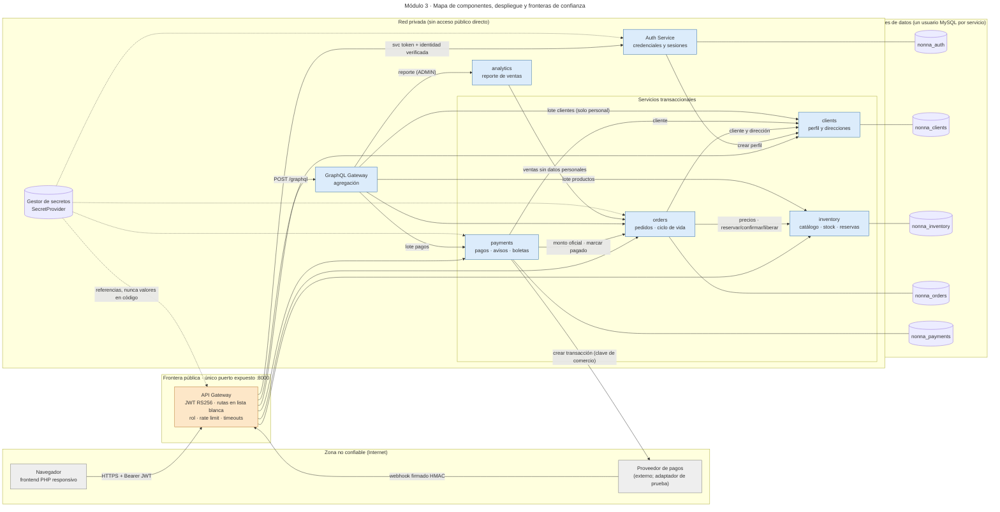
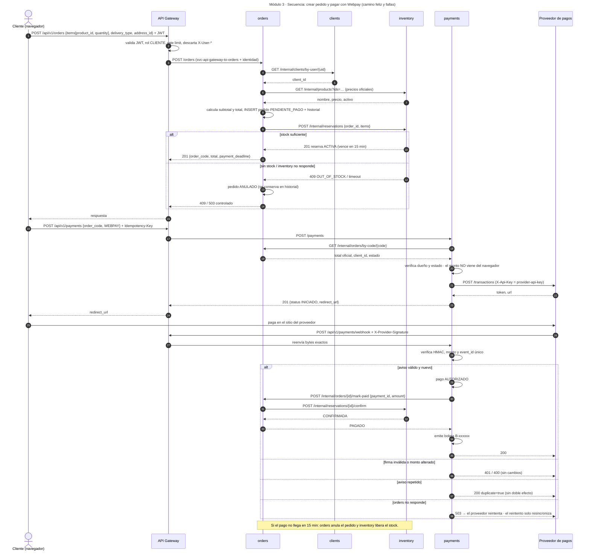
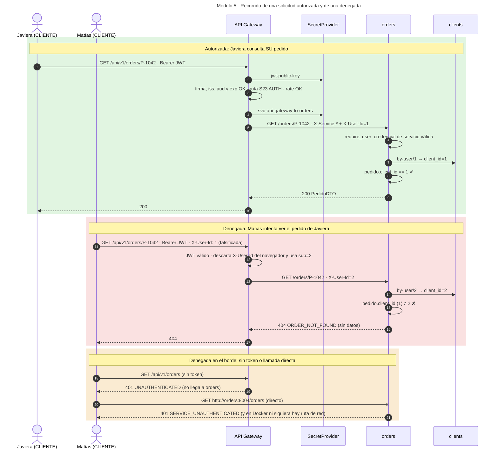

# Diagramas

Fuentes editables en esta carpeta (`diagramas/*.mmd`, Mermaid). GitHub los dibuja directamente aquí.
Para editarlos en **draw.io**: *Organizar → Insertar → Avanzado → Mermaid* y pegar el contenido del `.mmd`. También se pueden abrir en https://mermaid.live para exportar PNG/SVG al informe.

Leyenda UML: `*--` composición · `o--` agregación · `--` asociación · `..` referencia lógica entre servicios (id sin FK, cada base pertenece a un servicio) · `..>` dependencia (uso de una clase o contrato) · `<<service>>` servicio público · `<<DTO>>` objeto que sale al frontend · números = multiplicidad en cada extremo.

## Módulo 2 — UML de clases del dominio y servicios públicos

Fuente: [`diagramas/01-uml-dominio.mmd`](diagramas/01-uml-dominio.mmd)

```mermaid
---
title: "Módulo 2 · UML de clases del dominio y servicios públicos (La Nonna)"
---
classDiagram
    direction TB

    %% ===================== auth (nonna_auth)
    class Usuario {
        -id: Long
        -email: String
        -passwordHash: String
        -rol: Rol
        -activo: Boolean
        -intentosFallidos: Int
        -bloqueadoHasta: DateTime
    }
    class RefreshToken {
        -id: Long
        -tokenHash: String
        -expiraEn: DateTime
        -revocadoEn: DateTime
    }
    class PerfilPersonal {
        -nombre: String
        -apellido: String
        -cargo: String
        -fechaIngreso: Date
    }
    class Rol {
        <<enumeration>>
        CLIENTE
        TRABAJADOR
        ADMIN
    }

    %% ===================== clients (nonna_clients)
    class Cliente {
        -id: Long
        -authUserId: Long
        -run: String
        -nombre: String
        -apellido: String
        -email: String
        -telefono: String
        -notificarEmail: Boolean
        -eliminadoEn: DateTime
    }
    class Direccion {
        -id: Long
        -calle: String
        -comuna: String
        -referencia: String
        -esPredeterminada: Boolean
    }

    %% ===================== inventory (nonna_inventory)
    class Categoria {
        -id: Int
        -nombre: String
    }
    class Producto {
        -id: Long
        -sku: String
        -nombre: String
        -descripcion: String
        -precioClp: Int
        -activo: Boolean
    }
    class Stock {
        -cantidadDisponible: Int
        -cantidadReservada: Int
    }
    class ReservaStock {
        -id: Long
        -pedidoId: Long
        -cantidad: Int
        -estado: EstadoReserva
        -expiraEn: DateTime
    }

    %% ===================== orders (nonna_orders)
    class Pedido {
        -id: Long
        -codigo: String
        -clienteId: Long
        -estado: EstadoPedido
        -tipoEntrega: TipoEntrega
        -direccionEntrega: String
        -subtotalClp: Int
        -costoDespachoClp: Int
        -totalClp: Int
        +transicionar(nuevo: EstadoPedido, por: String)
    }
    class ItemPedido {
        -productoId: Long
        -nombreProducto: String
        -precioUnitarioClp: Int
        -cantidad: Int
    }
    class HistorialEstado {
        -desde: EstadoPedido
        -hacia: EstadoPedido
        -cambiadoPor: String
        -cambiadoEn: DateTime
    }
    class EstadoPedido {
        <<enumeration>>
        PENDIENTE_PAGO
        PAGADO
        PREPARANDO
        LISTO
        ENTREGADO
        ANULADO
    }

    %% ===================== payments (nonna_payments)
    class Pago {
        -id: Long
        -pedidoId: Long
        -clienteId: Long
        -montoClp: Int
        -metodo: MetodoPago
        -tokenProveedor: String
        -estado: EstadoPago
        -claveIdempotencia: String
    }
    class EventoPago {
        -idEventoProveedor: String
        -firmaValida: Boolean
        -payloadSha256: String
    }
    class Boleta {
        -numero: String
        -emitidaEn: DateTime
    }

    %% ===================== Relaciones del dominio (multiplicidad en ambos extremos)
    Usuario "1" *-- "0..*" RefreshToken : sesiones
    Usuario "1" -- "0..1" PerfilPersonal : personal
    Usuario --> Rol
    Usuario "1" .. "0..1" Cliente : authUserId (ref. lógica)
    Cliente "1" *-- "0..*" Direccion : direcciones
    Categoria "1" o-- "0..*" Producto : agrupa
    Producto "1" *-- "1" Stock : existencias
    Producto "1" -- "0..*" ReservaStock : reservado en
    Pedido "1" .. "0..*" ReservaStock : pedidoId (ref. lógica)
    Cliente "1" .. "0..*" Pedido : clienteId (ref. lógica)
    Pedido "1" *-- "1..*" ItemPedido : contiene
    ItemPedido "0..*" .. "1" Producto : productoId (copia nombre/precio)
    Pedido "1" *-- "1..*" HistorialEstado : bitácora
    Pedido --> EstadoPedido
    Pedido "1" .. "0..*" Pago : pedidoId (ref. lógica)
    Pago "1" *-- "0..*" EventoPago : avisos
    Pago "1" *-- "0..1" Boleta : comprobante

    %% ===================== DTO (lo que sale al frontend)
    class ProductoDTO {
        <<DTO>>
        id, name, description, category, price_clp, available
    }
    class PedidoDTO {
        <<DTO>>
        order_code, status, delivery_type, delivery_address, totales, items
    }
    class PerfilDTO {
        <<DTO>>
        first_name, last_name, email, phone, run, notify_email
    }
    class PagoDTO {
        <<DTO>>
        id, amount_clp, method, status, receipt_number, redirect_url
    }
    class TokenDTO {
        <<DTO>>
        access_token, expires_in, refresh_token, user
    }

    %% ===================== Servicios públicos (operación -> ID de servicio)
    class AuthService {
        <<service>>
        +registrar(datos) S01
        +iniciarSesion(email, clave) S02
        +refrescar(refreshToken) S03
        +cerrarSesion(refreshToken) S04
        +yo() S05
        +crearPersonal(datos) S06
    }
    class CatalogService {
        <<service>>
        +consultarCatalogo(filtro) S07
        +consultarProducto(id) S08
        +listarCategorias() S09
        +crearProducto(datos) S10
        +reemplazarProducto(id, datos) S11
        +desactivarProducto(id) S12
        +fijarStock(id, cantidad) S13
        +consultarStock() S14
    }
    class ClientService {
        <<service>>
        +verPerfil() S15
        +reemplazarPerfil(datos) S16
        +listarDirecciones() S17
        +agregarDireccion(datos) S18
        +reemplazarDireccion(id, datos) S19
        +listarClientes(pagina) S20
    }
    class OrderService {
        <<service>>
        +crearPedido(items, entrega) S21
        +listarPedidos(filtro) S22
        +verPedido(codigo) S23
        +cambiarEstado(codigo, estado) S24
        +anularPedido(codigo) S25
        +vencerPendientes() S26
    }
    class PaymentService {
        <<service>>
        +iniciarPago(codigo, metodo, idemKey) S27
        +verPago(id) S28
        +confirmarManual(id) S29
        +recibirAviso(evento, firma) S30
    }
    class AggregationService {
        <<service>>
        +misPedidos(pagina, tamano) S31
        +pedido(codigo) S31
        +pedidosActivos(pagina, tamano) S31
        +reporteVentas(desde, hasta) S31
    }

    AuthService ..> TokenDTO
    AuthService ..> Usuario
    CatalogService ..> ProductoDTO
    CatalogService ..> Producto
    ClientService ..> PerfilDTO
    ClientService ..> Cliente
    OrderService ..> PedidoDTO
    OrderService ..> Pedido
    PaymentService ..> PagoDTO
    PaymentService ..> Pago
    AggregationService ..> PedidoDTO
    AggregationService ..> ProductoDTO
    AggregationService ..> PagoDTO
```

## Módulo 5 — UML del API Gateway, políticas y GraphQL Gateway

Fuente: [`diagramas/02-uml-gateway.mmd`](diagramas/02-uml-gateway.mmd)

```mermaid
---
title: "Módulo 5 · UML de clases del API Gateway, políticas y GraphQL Gateway"
---
classDiagram
    direction LR

    class ApiGateway {
        <<público>>
        -maxBodyBytes: Int = 65536
        -upstreamTimeout: Float = 5s
        +proxy(request) Response
        -descartarCabecerasIdentidad(request)
        -forward(route, user, body) Response
    }
    class RouteDefinition {
        -id: String  (S01..S31)
        -method: String
        -external: String
        -internal: String
        -access: ANON o AUTH
        -roles: Rol[]
        -forwardHeaders: String[]
        +match(method, path) Params
    }
    class AuthenticationPolicy {
        -algoritmo: RS256
        -issuer: nonna-auth
        -audience: nonna-api
        +authenticate(request) UserCtx
    }
    class AuthorizationPolicy {
        +permitir(route, user) Boolean
    }
    class RateLimitPolicy {
        -nombre: default, auth, graphql, webhook
        -limitePorMinuto: Int
        +allow(clave) Boolean
    }
    class ServiceTarget {
        -nombre: String
        -baseUrl: String
        -credentialRef: svc-api-gateway-to-X
    }
    class SecretProvider {
        <<interface>>
        +getSecret(ref) String
        -cacheTTL = 60s
    }
    class ServiceCredential {
        -ref: svc-llamador-to-destino
        -llamador: String
        -destino: String
    }
    class UserCtx {
        <<valor>>
        +userId: Long
        +role: Rol
        +email: String
        +asHeaders()
    }
    class InternalServiceGuard {
        <<en cada servicio>>
        +requireCallers(nombres) Caller
        +requireUser(roles) UserCtx
    }
    class AuthServiceApi {
        <<service>>
        +login() / refresh() / logout()
        -firma con jwt-private-key
    }

    class GraphQLGateway {
        <<privado>>
        -maxDepth = 6
        -maxAliases = 10
        -maxTokens = 800
        -introspeccion = false
        +execute(query, ctx)
    }
    class Schema
    class QueryResolver {
        +misPedidos()
        +pedido()
        +pedidosActivos()
        +reporteVentas()
    }
    class IsStaffPermission {
        +hasPermission(info) Boolean
    }
    class GraphQLContext {
        -user: UserCtx
        +products: DataLoader
        +payments: DataLoader
        +clients: DataLoader
    }
    class OrdersAdapter {
        <<adaptador REST>>
        GET /internal/orders
    }
    class InventoryAdapter {
        <<adaptador REST>>
        GET /internal/products?ids
    }
    class PaymentsAdapter {
        <<adaptador REST>>
        GET /internal/payments?order_ids
    }
    class ClientsAdapter {
        <<adaptador REST>>
        GET /internal/clients?ids
    }
    class AnalyticsService {
        <<privado · analítica>>
        +salesSummary(desde, hasta)
    }

    ApiGateway "1" *-- "1..*" RouteDefinition : rutas (31)
    ApiGateway "1" --> "1" AuthenticationPolicy
    ApiGateway "1" --> "1" AuthorizationPolicy
    RouteDefinition "0..*" --> "1" RateLimitPolicy : aplica
    RouteDefinition "1..*" --> "1" ServiceTarget : destino
    ServiceTarget "1" --> "1" ServiceCredential : usa
    ApiGateway ..> SecretProvider : obtiene credencial
    AuthenticationPolicy ..> SecretProvider : jwt-public-key
    AuthenticationPolicy ..> UserCtx : produce
    AuthorizationPolicy ..> UserCtx
    ServiceTarget ..> InternalServiceGuard : verificada por
    AuthServiceApi ..> SecretProvider : jwt-private-key
    ServiceTarget <|.. AuthServiceApi : auth
    ServiceTarget <|.. GraphQLGateway : graphql

    GraphQLGateway "1" *-- "1" Schema
    Schema "1" *-- "1" QueryResolver
    QueryResolver ..> IsStaffPermission : campo cliente/telefono
    QueryResolver ..> GraphQLContext
    GraphQLContext "1" *-- "1" InventoryAdapter : DataLoader productos
    GraphQLContext "1" *-- "1" PaymentsAdapter : DataLoader pagos
    GraphQLContext "1" *-- "1" ClientsAdapter : DataLoader clientes
    QueryResolver ..> OrdersAdapter
    QueryResolver ..> AnalyticsService
    GraphQLGateway ..> InternalServiceGuard : solo llamador api-gateway
    OrdersAdapter ..> SecretProvider : svc-graphql-to-orders
```

## Módulo 3 — Mapa de componentes y despliegue

Fuente: [`diagramas/03-mapa-componentes.mmd`](diagramas/03-mapa-componentes.mmd)

## Módulo 3 — Secuencia: pedido y pago Webpay

Fuente: [`diagramas/04-secuencia-compra.mmd`](diagramas/04-secuencia-compra.mmd)

## Módulo 5 — Solicitud autorizada y denegada

Fuente: [`diagramas/05-secuencia-autorizada-denegada.mmd`](diagramas/05-secuencia-autorizada-denegada.mmd)

